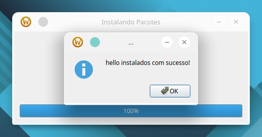

<div align="center">


# deb-manager-gui

Qt 6 progress window that installs or removes APT packages and `.deb` files on behalf of other programs.

[](https://github.com/mainuan/deb-manager-gui/actions/workflows/ci.yml)
[](LICENSE)


[Português](README.md) · **English**

</div>

---

<p align="center"></p>


## About

`deb-manager-gui` is a Python/PyQt6 script that runs package operations given
on the command line and shows their progress in a window, then reports success
or failure in a message box. It is meant to be started by other programs,
usually through `pkexec`, and has no menu entry.

## Features

- `--in` / `--rm`: install or remove one or more packages with `apt-get`.
- `--deb`: install local `.deb` files with `dpkg -i`, then resolve missing dependencies with `apt-get -f install`.
- Progress bar computed from the `apt-get`/`dpkg` output; custom window text with `--tx`.
- Non-interactive operations that keep existing configuration files.
- Runs the tools directly as root (pkexec) or through `sudo` otherwise.
- 33 languages; under `pkexec` it uses the calling user's Plasma language (`~/.config/plasma-localerc`) or `/etc/default/locale`.

## Installation

Preinstalled in the Mainuan Linux ISO. There is no versioned release yet; the
first one will be **1.0.0**, with the `.deb` and `SHA256SUMS`. Until then,
build it on Kubuntu/Ubuntu 26.04:

```bash
git clone https://github.com/mainuan/deb-manager-gui.git
cd deb-manager-gui
sudo apt build-dep ./
dpkg-buildpackage -us -uc -b      # runs tests/test_i18n.py and tests/test_worker.py
sudo apt install ../deb-manager-gui_1.0.0_all.deb
```

## Usage

```bash
pkexec env DISPLAY=$DISPLAY XAUTHORITY=$XAUTHORITY deb-manager-gui --in htop neofetch
pkexec env DISPLAY=$DISPLAY XAUTHORITY=$XAUTHORITY deb-manager-gui --rm htop
pkexec env DISPLAY=$DISPLAY XAUTHORITY=$XAUTHORITY deb-manager-gui --deb ./file.deb --tx "Installing"
```

Everything after `--tx` is the message. See `man deb-manager-gui`.

## Building and testing

CI ([`ci.yml`](.github/workflows/ci.yml)) runs `po/i18n.sh check-pot` and
`po/i18n.sh validate`, builds and lints the package, installs, reinstalls and
removes it in a clean Ubuntu 26.04 container and checks the usage text in
Portuguese and English. Releases are published only from `v*` tags.

## Translations

33 languages via gettext; see [docs/i18n/README.md](docs/i18n/README.md).

## Credits

Charles Santana ([@selrahcsan](https://github.com/selrahcsan)), author, and
Rafael Ruscher ([@ruscher](https://github.com/ruscher)).

## License

[MIT](LICENSE), Copyright (c) 2025 Charles Santana.
